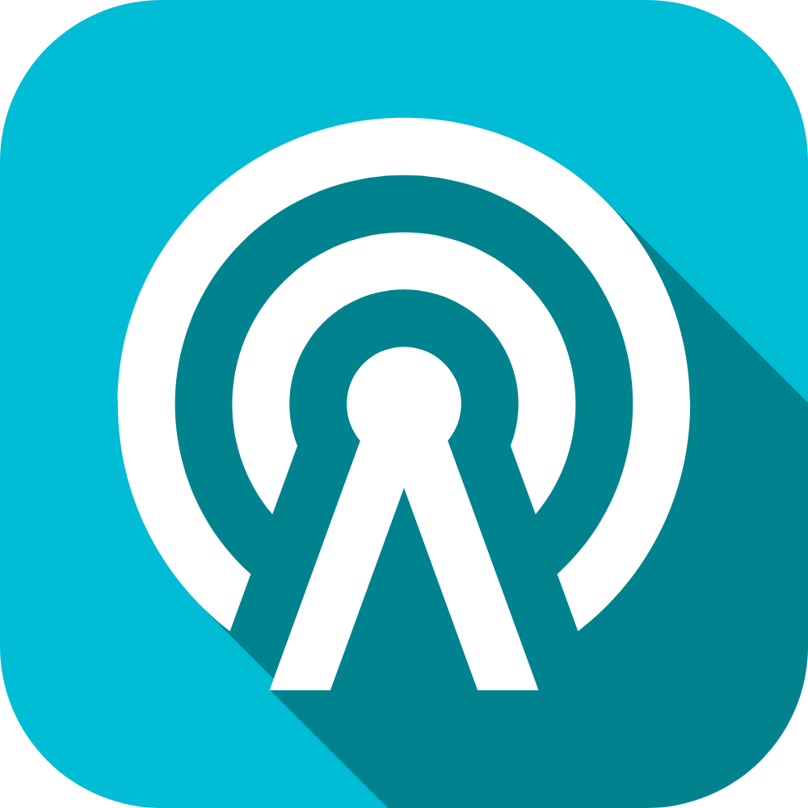

# d3m0n OS pre installed apps

## Default apps list
- d3m0n apps
  - communication
    - [x]  [contacts](./communication/contacts)
    - [x]  [phone](./communication/phone)
    - [x]  [messages](./communication/messages)   
  - system
    - [x]  [settings](./system/settings)
    - [x]  [launcher](./system/launcher)
    - [ ]  [keyboard](./system/keyboard)
  - photo
    - [x]  [camera](./photo/camera)
    - [x]  [gallery](./photo/gallery)
  - misc
    - [x]  [files](./mysc/files)
    - [x]  [calculator](./mysc/calculator)
    - [ ]  [browser](./mysc/browser)
    - [x]  [store](./mysc/store)
    - [x]  [modules manager](./mysc/modules)
  - modules
    - [ ]  [badUSB](./modules/badUSB)
    - [ ]  [infrared](./modules/infrared)
    - [ ]  [wifi](./modules/wifi)
    - [ ]  [radio](./modules/radio)
  - testing (for debug purposes)
    - [x]  [Color test](./testing/terminal)
    - [x]  [Color test](./testing/color)
    - [x]  [HelloWorld](./testing/hello_world)
